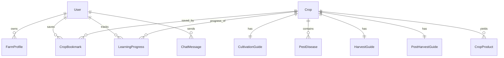

# Database Schema & Data Models

## First Farmer Agriculture System

The database architecture is fully normalized and implemented via SQLAlchemy ORM with support for **MySQL 8** (recommended production) and **SQLite** (instant local development fallback).

### Table Definitions

#### 1. `users`
- `id` (INTEGER, Primary Key, Auto-increment)
- `full_name` (VARCHAR(100), Not Null)
- `email` (VARCHAR(150), Unique, Indexed, Not Null)
- `password_hash` (VARCHAR(255), Not Null)
- `role` (VARCHAR(20), Not Null, Default: 'student') — 'student' or 'admin'
- `preferred_language` (VARCHAR(10), Not Null, Default: 'en') — 'en', 'ta', 'hi'
- `created_at` (DATETIME, Not Null)
- `updated_at` (DATETIME, Not Null)

#### 2. `crops`
- `id` (INTEGER, Primary Key, Auto-increment)
- `name` (VARCHAR(100), Indexed, Not Null)
- `scientific_name` (VARCHAR(120), Nullable)
- `category` (VARCHAR(50), Indexed, Not Null) — 'Cereal', 'Vegetable', 'Cash Crop', 'Fruit', 'Pulse', 'Millet'
- `description` (TEXT, Not Null)
- `suitable_regions` (VARCHAR(255), Not Null)
- `soil_requirements` (VARCHAR(255), Not Null)
- `climate_requirements` (VARCHAR(255), Not Null)
- `season` (VARCHAR(100), Indexed, Not Null)
- `water_requirement` (VARCHAR(50), Not Null) — 'Low', 'Medium', 'High'
- `difficulty_level` (VARCHAR(50), Not Null, Default: 'Beginner')
- `image_path` (VARCHAR(255), Nullable)
- `is_published` (BOOLEAN, Not Null, Default: True)
- `created_at` (DATETIME, Not Null)
- `updated_at` (DATETIME, Not Null)

#### 3. `cultivation_guides`
- `id` (INTEGER, Primary Key, Auto-increment)
- `crop_id` (INTEGER, Foreign Key to `crops.id`, Unique, Not Null)
- `land_preparation` (TEXT, Not Null)
- `seed_selection` (TEXT, Not Null)
- `sowing_method` (TEXT, Not Null)
- `irrigation` (TEXT, Not Null)
- `nutrient_management` (TEXT, Not Null)
- `weed_management` (TEXT, Not Null)
- `growth_stages` (TEXT, Not Null)
- `beginner_mistakes` (TEXT, Nullable)

#### 4. `pest_diseases`
- `id` (INTEGER, Primary Key, Auto-increment)
- `crop_id` (INTEGER, Foreign Key to `crops.id`, Not Null)
- `name` (VARCHAR(120), Indexed, Not Null)
- `type` (VARCHAR(50), Not Null) — 'Pest' or 'Disease'
- `symptoms` (TEXT, Not Null)
- `conditions` (TEXT, Not Null)
- `prevention` (TEXT, Not Null)
- `management` (TEXT, Not Null)
- `source_reference` (VARCHAR(255), Nullable)
- `last_reviewed_at` (VARCHAR(100), Nullable)

#### 5. `harvest_guides`
- `id` (INTEGER, Primary Key, Auto-increment)
- `crop_id` (INTEGER, Foreign Key to `crops.id`, Unique, Not Null)
- `maturity_indicators` (TEXT, Not Null)
- `approximate_harvest_period` (VARCHAR(100), Not Null)
- `harvesting_method` (TEXT, Not Null)
- `handling_precautions` (TEXT, Not Null)
- `storage_preparation` (TEXT, Not Null)

#### 6. `post_harvest_guides`
- `id` (INTEGER, Primary Key, Auto-increment)
- `crop_id` (INTEGER, Foreign Key to `crops.id`, Unique, Not Null)
- `cleaning_and_grading` (TEXT, Not Null)
- `storage_method` (TEXT, Not Null)
- `preservation_method` (TEXT, Not Null)
- `processing_method` (TEXT, Not Null)
- `packaging_method` (TEXT, Not Null)
- `food_uses` (TEXT, Not Null)
- `industrial_uses` (TEXT, Not Null)
- `by_products` (TEXT, Not Null)

#### 7. `crop_products`
- `id` (INTEGER, Primary Key, Auto-increment)
- `crop_id` (INTEGER, Foreign Key to `crops.id`, Not Null)
- `product_name` (VARCHAR(150), Not Null)
- `product_category` (VARCHAR(100), Not Null)
- `raw_material` (VARCHAR(150), Not Null)
- `processing_overview` (TEXT, Not Null)
- `common_uses` (TEXT, Not Null)
- `storage_considerations` (TEXT, Not Null)
- `potential_value_addition` (TEXT, Not Null)

#### 8. `crop_bookmarks`
- `id` (INTEGER, Primary Key, Auto-increment)
- `user_id` (INTEGER, Foreign Key to `users.id`, Not Null)
- `crop_id` (INTEGER, Foreign Key to `crops.id`, Not Null)
- `created_at` (DATETIME, Not Null)
- *Constraint*: `uq_user_crop_bookmark` (`user_id`, `crop_id`)

#### 9. `learning_progress`
- `id` (INTEGER, Primary Key, Auto-increment)
- `user_id` (INTEGER, Foreign Key to `users.id`, Not Null)
- `crop_id` (INTEGER, Foreign Key to `crops.id`, Nullable)
- `module_name` (VARCHAR(100), Not Null)
- `completion_status` (VARCHAR(50), Not Null, Default: 'in_progress')
- `progress_percentage` (INTEGER, Not Null, Default: 0)
- `last_accessed_at` (DATETIME, Not Null)
- *Constraint*: `uq_user_crop_module_progress` (`user_id`, `crop_id`, `module_name`)

#### 10. `chat_messages`
- `id` (INTEGER, Primary Key, Auto-increment)
- `user_id` (INTEGER, Foreign Key to `users.id`, Nullable)
- `conversation_id` (VARCHAR(100), Indexed, Not Null)
- `role` (VARCHAR(20), Not Null) — 'user' or 'assistant'
- `message_text` (TEXT, Not Null)
- `created_at` (DATETIME, Not Null)
